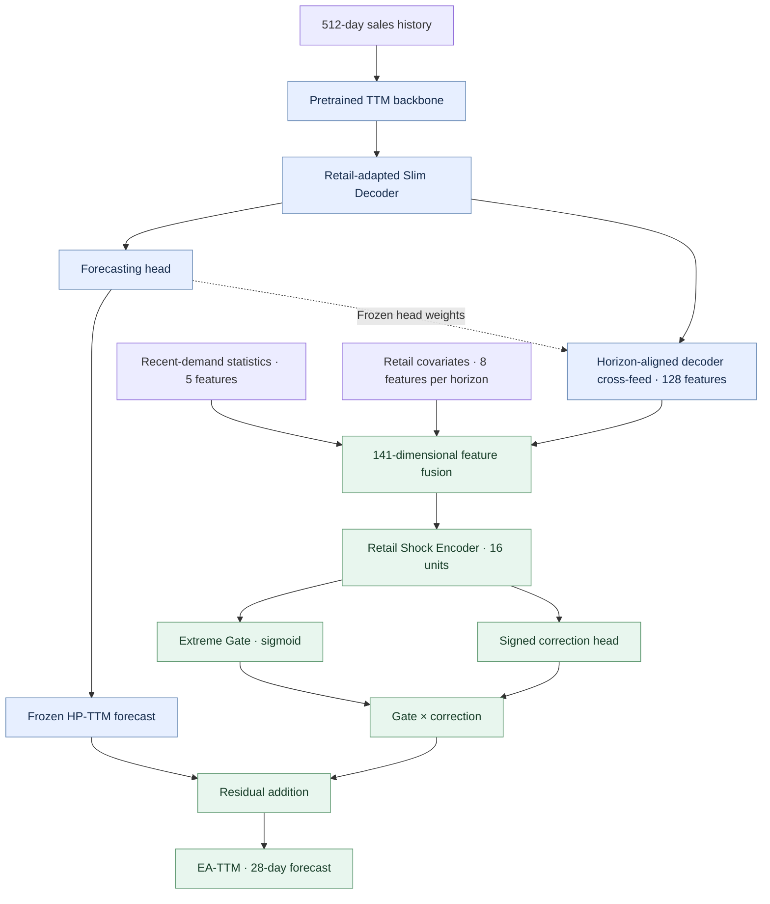

<div align="center">

<h1>Extreme-Aware Tiny Time Mixers (EA-TTM)</h1>
<h3>Retail demand forecasting under regime shifts</h3>

<p><strong>An investigation of lightweight, decoder-informed residual adaptation for intermittent retail sales</strong></p>
<p><strong>Kamile Seidu</strong> · MSc Data Science · Department of Computer Science, University of Ghana · 2026</p>

<p>
  
  
  
  
  
</p>

<p>
  <a href="#overview">Overview</a> ·
  <a href="#model-architecture">Architecture</a> ·
  <a href="#results">Results</a> ·
  <a href="#repository-structure">Repository guide</a> ·
  <a href="#getting-started-and-reproducibility">Reproducibility</a> ·
  <a href="#citation">Citation</a>
</p>

</div>

---

## Overview

Retail demand at the individual **store–item** level is frequently intermittent: many days record no sales, while occasional upward or downward deviations make prediction difficult. A forecasting model can perform reasonably well on typical days yet make large errors on unusual ones.

**EA-TTM** investigates whether a small residual adapter can improve a retail-adapted **Tiny Time Mixer (TTM)** without retraining its pretrained backbone. The adapter combines frozen decoder representations with recent-demand statistics and horizon-specific retail covariates. It learns a signed forecast correction and an **Extreme Gate** that scales the correction.

The research asks two connected questions:

- Can decoder-informed residual correction reduce error, especially on statistically extreme sales observations?
- Does explicitly gating that correction improve forecasting, or can the gate suppress useful adjustments?

> **Main finding:** Lightweight decoder-informed residual correction shows a modest squared-error benefit on the locked M5 test window. **Multiplicative gating was not superior to the ungated correction variant.** The gains do not generalise to every metric or demand regime.

### At a glance

| Setting | Experimental specification |
|:--|:--|
| Dataset | M5 Forecasting Accuracy, bottom-level Walmart store–item sales |
| Series | **30,490** |
| Historical context | **512 days** |
| Forecast horizon | **28 days** |
| Zero-sales prevalence in audited training observations | **68.37%** |
| Primary model | Validation-selected **EA-TTM, epoch 15** |
| Additional trainable parameters | **2,466** |
| Frozen retail-adapted base | Approximately **799,756 parameters** |
| Experimental environment | Google Colab, NVIDIA T4 GPU |
| Final evaluation | One chronologically held-out **28-day** window |

## Model architecture

The research uses **two adaptation stages**:

1. **Retail head probing:** retain the pretrained TTM backbone; train its Slim Decoder and forecasting head on the retail training windows. Freeze the resulting complete **HP-TTM** base forecaster.
2. **Residual adaptation:** keep HP-TTM frozen; train the external EA-TTM adapter on frozen decoder features, recent-demand summaries and forecast-horizon retail covariates.



The forecasting rule is

$$
\widehat{y}^{\mathrm{EA}}_{t+h}
= \widehat{y}^{\mathrm{HP}}_{t+h} + g_{t+h}\,\Delta_{t+h},
\qquad h=1,\ldots,28.
$$

Here, $\widehat{y}^{\mathrm{HP}}$ is the frozen base forecast, $g\in(0,1)$ is the learned gate and $\Delta$ is the signed residual correction. **The ungated ablation uses** $\widehat{y}^{\mathrm{HP}}+\Delta$.

The decoder cross-feed reuses the frozen forecasting-head weights to align **nine decoder patches**, each with **128 features**, to the **28** forecast positions. No separate trainable horizon-alignment layer is introduced.

### Extreme-demand definition

Extreme labels are defined *after observing the target* for supervision and evaluation, not supplied as forecast-time inputs. Each future observed sale is compared with the median of the preceding 28 historical days, scaled by `max(1, 1.4826 × MAD)`. The extreme threshold is the **training-derived 95th-percentile shock score (2.0)**, applied with a strict greater-than rule. This produced an extreme-label rate of approximately **4.705%** in training.

The adapter is trained using **normalised final-forecast MSE plus normalised binary cross-entropy** on extreme labels. The implemented loss **does not** use tail-weighted Huber loss.

## Experimental design

The dataset is split chronologically. The four training origins are deliberately sampled rather than covering every possible rolling origin.

| Partition | Forecast origin | Forecast target days |
|:--|--:|:--|
| Training 1 | `d_512` | `d_513`–`d_540` |
| Training 2 | `d_960` | `d_961`–`d_988` |
| Training 3 | `d_1409` | `d_1410`–`d_1437` |
| Training 4 | `d_1857` | `d_1858`–`d_1885` |
| Validation | `d_1885` | `d_1886`–`d_1913` |
| **Locked final test** | **`d_1913`** | **`d_1914`–`d_1941`** |

All model and checkpoint selection was carried out **before the locked test**. The primary gated model is the epoch-15 checkpoint selected using a balanced validation criterion covering overall and extreme MSE. The subsequent test results were **not used to replace it** with a better-performing ablation.

## Results

All values below come from the **same locked 28-day final-test period** and are archived in [`results/tables/11_MASTER_RESULTS_TABLE.csv`](results/tables/11_MASTER_RESULTS_TABLE.csv). **Lower is better** for all error metrics.

### Main forecasting comparison

| Model | MSE ↓ | RMSE ↓ | MAE ↓ | WAPE ↓ |
|:--|--:|--:|--:|--:|
| Weekly seasonal naive | 7.165766 | 2.676895 | 1.243972 | 0.862181 |
| Zero-shot TTM | 4.637857 | 2.153569 | 1.041414 | 0.721791 |
| Frozen HP-TTM | 4.563047 | 2.136129 | **1.028902** | **0.713119** |
| **Primary EA-TTM** | **4.528610** | **2.128053** | 1.037919 | 0.719369 |

Relative to frozen HP-TTM, the primary gated EA-TTM achieved:

- **0.7547% lower overall MSE** and **1.8591% lower extreme-regime MSE**.
- **2.1290% lower positive-extreme MSE**, but **1.9248% higher negative-extreme MSE**.
- **0.7323% higher normal-regime MSE** and approximately **0.8764% worse MAE and WAPE**.
- Lower overall and extreme MSE on **27 of 28** forecast horizons; MAE and WAPE worsened on all 28.


*Figure: Overall final-test MSE across the four models used in the streamlined presentation. The connecting line orders development stages, not a continuous independent variable.*

### Ablations: a necessary qualification

The main presentation compares four models for clarity. **The repository preserves the other variants and their unfavourable evidence for the gate.**

| Model | Overall MSE ↓ | Extreme MSE ↓ | MAE ↓ |
|:--|--:|--:|--:|
| Frozen HP-TTM | 4.563047 | 44.172408 | **1.028902** |
| Retail-only gated adapter | 4.532796 | 43.308546 | 1.038483 |
| **Ungated cross-feed adapter** | **4.513243** | **42.319173** | 1.041909 |
| Primary gated EA-TTM | 4.528610 | 43.351182 | 1.037919 |

**The ungated cross-feed adapter achieved lower overall and extreme MSE than the primary gated EA-TTM on both validation and the locked test.** The gate nevertheless displayed extreme-label discrimination (test **AUROC 0.767717**, **AUPRC 0.201221**). Discriminating an extreme observation is therefore not equivalent to selecting a numerical correction that minimises forecasting error.

The ablations do **not** isolate each component causally: the retail-only model has fewer input features *and* fewer parameters (418 versus 2,466), while removing the gate also removes its auxiliary BCE-supervised branch.

### Improvement across the forecast horizon


*Figure: Positive percentages indicate lower MSE for EA-TTM than for frozen HP-TTM. Horizon 6 was the exception to the broadly positive overall and extreme MSE changes.*

The paired series bootstrap (2,000 replicates) produced a pooled **HP-TTM minus EA-TTM MSE difference of 0.034437** with a **95% percentile interval of [0.029668, 0.039819]**. This is conditional on resampling store–item series within one test window; it does not measure uncertainty across different seasons or retailers.

## Repository structure

The companion archive contains **26 Jupyter notebooks**, **24 execution guides**, saved result tables and figures, and a file-integrity manifest. Versioned notebooks preserve development history; they are **not** separate independent experiments.

```text
.
├── README.md                         # This file (add at repository root)
├── MANIFEST.json                     # SHA-256 and size of archived files
├── README.txt                        # Original archive notes
├── notebooks/                        # Colab experiment and report notebooks (00–13)
│   ├── 00_Project_Bootstrap_and_Environment_Audit_v3.ipynb
│   ├── 01_TTM_Model_Contract_and_Interface_Audit_v4.ipynb
│   ├── 02_M5_Data_Contract_and_Split_Audit_v2.ipynb
│   ├── 03_Zero_Shot_TTM_Validation_Benchmark.ipynb
│   ├── 04_TTM_Head_Probing.ipynb
│   ├── 05_Slim_Decoder_Crossfeed_Audit_and_Cache_v3.ipynb
│   ├── 06_Retail_Shock_Feature_Engineering_and_Leakage_Audit_v2.ipynb
│   ├── 07_Extreme_Target_and_EA_TTM_Architecture.ipynb
│   ├── 08_EA_TTM_Adapter_Training_and_Validation.ipynb
│   ├── 09_Validation_Ablation_and_Mechanism_Audit.ipynb
│   ├── 10_Locked_Final_Test_Evaluation.ipynb
│   ├── 11_Reporting_Defense_Evidence_Package.ipynb
│   ├── 11B_Horizon_Performance_Line_Graphs.ipynb
│   ├── 12_Final_Results_and_Discussion.ipynb
│   └── 13_Final_LaTeX_Report_Assembly_and_Compilation_v4.ipynb
├── instructions/                     # Notebook-specific run notes and revisions
├── results/
│   ├── tables/                       # Audits, validation, final-test and ablation CSVs
│   ├── figures/                      # Original research figures and horizon diagnostics
│   └── *.md                          # Research evidence and limitations summaries
└── figures/
    └── 14R/                          # Updated presentation line charts (image outputs)
```

*The tree highlights key notebooks rather than every preserved intermediate revision. The 14R chart images and execution guide are present, but the **14R chart-generation notebook is not included in this archive**.*

## Getting started and reproducibility

### 1. Obtain the project files

Unpack the companion source-and-results archive and add this `README.md` to its **top-level directory**. On GitHub, upload the extracted folders and files, not only the ZIP file, so notebooks, figures and tables can be browsed individually.

### 2. Prepare the execution environment

The experiments were developed in **Google Colab with an NVIDIA T4 GPU**. A compatible Python/PyTorch and IBM Granite time-series environment is needed. Start with the environment bootstrap notebook and its guide in [`instructions/`](instructions/); the source notebooks install and audit the dependencies used in the recorded workflow.

> This archive is **not a self-contained, one-command reproduction**. Its notebooks refer to files saved in the original Colab/Google Drive workspace, including data, model weights and metadata that are not in the public source package. An end-to-end clean-room reproduction has not been verified from the archive alone.

### 3. Obtain the M5 data

Download the source files from the [M5 Forecasting Accuracy dataset on Kaggle](https://www.kaggle.com/competitions/m5-forecasting-accuracy/data), subject to its competition rules. Place the following under the Colab project root:

```text
/content/drive/MyDrive/EA_TTM_RETAIL/data/raw/m5/
├── calendar.csv
├── sales_train_evaluation.csv
└── sell_prices.csv
```

The locked experiment uses `sales_train_evaluation.csv`, which contains the `d_1`–`d_1941` sales history. Do not substitute the shorter `sales_train_validation.csv` without redesigning the experiment.

### 4. Restore checkpoint and metadata files

The **trained model binaries are not distributed in this source archive**. The original project workspace contains the relevant files at paths such as:

```text
/content/drive/MyDrive/EA_TTM_RETAIL/
├── models/
│   ├── pretrained_ttm/
│   ├── head_probed_ttm/
│   └── ea_ttm_adapter/adapter_state.pt
├── runs/
│   ├── 04_head_probe/checkpoints/best_validation_state.pt
│   ├── 08_ea_ttm_training/checkpoints/best_balanced_state.pt
│   └── 09_validation_ablation/checkpoints/
│       ├── retail_only_gated_best_state.pt
│       └── ungated_crossfeed_best_state.pt
└── metadata/
    ├── 02_SPLIT_MANIFEST.json
    ├── 06_FEATURE_CONTRACT.json
    ├── 07_EXTREME_TARGET_CONTRACT.json
    ├── 09_MODEL_DEVELOPMENT_LOCK.json
    └── 10_FINAL_EVALUATION_LOCK.json
```

These are **local Colab/Drive paths, not public download links**. Independent execution of later stages requires the appropriate original checkpoint and experiment metadata, or a separately documented reproduction of the earlier training stages.

### 5. Follow the recorded development order

Use the numbered notebooks and their corresponding instructions, in sequence:

| Stages | Purpose |
|:--|:--|
| `00–02` | Runtime setup, TTM interface checks, M5 splits and leakage audits |
| `03–04` | Zero-shot benchmark and frozen-backbone retail head probing |
| `05–07` | Decoder cross-feed, retail features, extreme labels and adapter definition |
| `08–09` | Gated adapter training, validation-based selection and ablation audit |
| `10` | **Locked final-test evaluation** |
| `11–13` | Reporting, horizon diagnostics and thesis/report generation |
| `14R` | Archived line-chart revisions only; **not new model training** |

For stages with revised versions (for example, `01 ... v4` and `02 ... v2`), consult the matching `_RUN.md` guide before execution. The older notebooks remain for provenance, and some contain superseded checks or fixes.

**Evaluation rule:** The epoch-15 primary checkpoint, data splits, threshold and feature definitions must remain fixed when reproducing the reported test. Do not tune or select a new primary model using the locked test.

### 6. Verify the archived results

Useful starting points are:

- [`results/tables/11_MASTER_RESULTS_TABLE.csv`](results/tables/11_MASTER_RESULTS_TABLE.csv) — final-test model comparison.
- [`results/tables/10_FINAL_TEST_REGIME_METRICS.csv`](results/tables/10_FINAL_TEST_REGIME_METRICS.csv) — normal, extreme, positive and negative regimes.
- [`results/tables/10_FINAL_TEST_BOOTSTRAP.csv`](results/tables/10_FINAL_TEST_BOOTSTRAP.csv) — paired-bootstrap estimate.
- [`results/tables/11B_PRIMARY_VS_HP_HORIZON_COMPARISON.csv`](results/tables/11B_PRIMARY_VS_HP_HORIZON_COMPARISON.csv) — horizon-wise gains and losses.
- [`MANIFEST.json`](MANIFEST.json) — archived file hashes and sizes.

The manifest covers the **original archive members**; a subsequently added `README.md` is not included in those hashes.

## Limitations and responsible interpretation

- **One retailer-derived dataset and one held-out calendar window.** Large numbers of store–item forecasts are not independent seasonal repetitions.
- **Statistical extremes are not independently verified regime changes.** Labels describe deviations from recent sales, not their causes.
- **Future selling prices are retrospective benchmark inputs.** Live deployment would require planned prices or a separate scenario/price forecast.
- **Trade-offs across metrics.** Primary EA-TTM improved pooled MSE while worsening MAE, WAPE and some regimes.
- **Ablation confounding.** Input capacity and training supervision differ between certain variants.
- **Trainable parameters are not end-to-end cost.** The complete frozen HP-TTM must still run at inference time.
- **External pretraining-data overlap is not independently ruled out** by the archived records.

The results support a **small, decoder-informed residual correction pathway** in this specific evaluation. They do **not** establish universal superiority of gated residual forecasting, improved inventory costs or better performance across untested retailers and seasons.

## Research resources

- **Tiny Time Mixers:** Ekambaram, V. et al. (2024). *Tiny Time Mixers (TTMs): Fast Pre-trained Models for Enhanced Zero/Few-shot Forecasting of Multivariate Time Series*. [NeurIPS paper](https://papers.nips.cc/paper_files/paper/2024/hash/874a4d89f2d04b4bcf9a2c19545cf040-Abstract-Conference.html).
- **Pretrained TTM family:** [IBM Granite Time Series TTM R2](https://huggingface.co/ibm-granite/granite-timeseries-ttm-r2). The study used an audited checkpoint; consult the experiment records for its exact resolved revision.
- **M5 dataset:** [M5 Forecasting Accuracy — Kaggle](https://www.kaggle.com/competitions/m5-forecasting-accuracy/data).

## Citation

If you use the project in academic work, please credit the thesis and relevant upstream TTM and M5 sources. A suggested thesis citation is:

```bibtex
@mastersthesis{seidu2026eattm,
  author = {Seidu, Kamile},
  title  = {Extreme-Aware Tiny Time Mixers (EA-TTM) for Retail Demand Forecasting under Regime Shifts},
  school = {University of Ghana},
  year   = {2026},
  type   = {MSc Data Science thesis}
}
```

## Usage, access and acknowledgement

This repository documents an academic research project. **No software licence is asserted by this README**; check the repository's `LICENSE` file, if provided, before assuming reuse permissions. M5 data and IBM pretrained model weights are subject to their respective source terms.

For questions about archived experiments, missing checkpoints or access to additional reproducibility material, use the repository's GitHub Issues area or contact the maintainer through their published GitHub profile.

---

<div align="center">
  <sub>Research by Kamile Seidu · Department of Computer Science · University of Ghana · 2026</sub>
</div>
